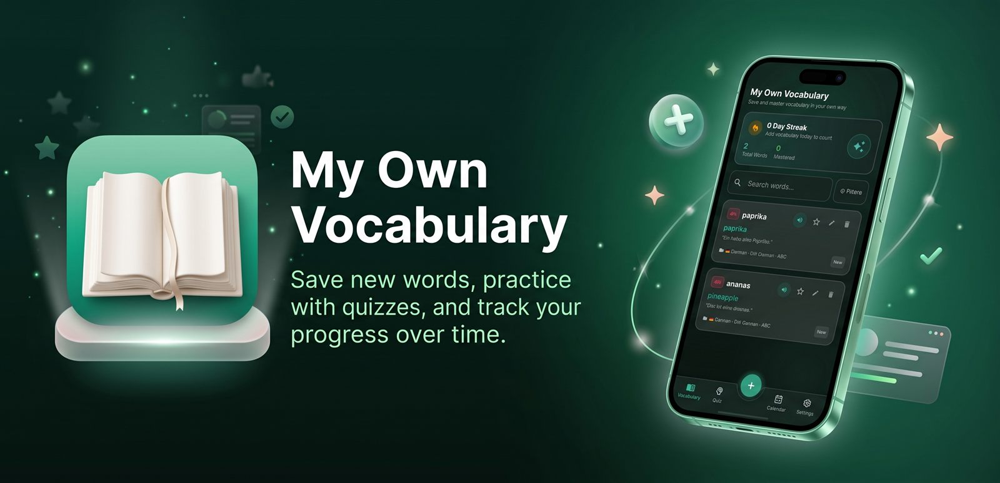

# 🌿 My Own Vocabulary Web

  
   
  

 

Save new words, practice with quizzes, and track your progress over time.

> [!NOTE]
> This repository contains the web landing page and companion site for the My Own Vocabulary Android app.

---

## ✨ Key Features

- **🗂️ 3-Tier Folder Structure**: Organize vocabulary as **Languages → Sources → Folders** with independent language pairs and cascading filters.
- **🎨 German Article & Gender Colors**: Instant recognition with signature color coding for `der` (blue), `die` (rose), and `das` (emerald), plus distinct part-of-speech badges.
- **🧠 Active Recall Quizzes**: Multiple choice, 3D flashcards, spelling tests, and a dedicated "Retry Mistakes" mode.
- **📅 Daily Calendar & Streaks**: A month grid with per-day word indicators, daily activity inspection, and a hero streak tracker.
- **🔊 Native Text-To-Speech**: Authentic pronunciation in 29+ languages with configurable rate and pitch.
- **🔒 Offline-First & Cloud Sync**: Local Room database with two-way Firebase Firestore sync, Google Sign-In, and JSON backup/import.
- **🌓 Dynamic UI**: Light, Dark, and System theme modes with premium glassmorphism and tactile spring animations.

---

## 🚀 Tech Stack

- **Structure**: Semantic HTML5
- **Styling**: [Tailwind CSS](https://tailwindcss.com/) for a modern, responsive interface.
- **Animations**: [GSAP](https://greensock.com/gsap/) for smooth, reveal-on-scroll transitions.
- **Interactivity**: Vanilla JavaScript for theme switching and UI logic.

---

## 🤝 Support the Mission

My Own Vocabulary is free and 100% ad-free. If it helps you learn, consider supporting its maintenance and future development:

- **International**: [Donate via Stripe](https://donate.stripe.com/3cI8wO6bWcqd7F46az8AE01)
- **Bangladesh**: bKash Send Money to `01773615582` (Personal)

---

## ⚖️ License

Distributed under the MIT License. See `LICENSE` for more information.

---

Built with ❤️ by [Sahed Alom Sumit](https://sahedalomsumit.com)
